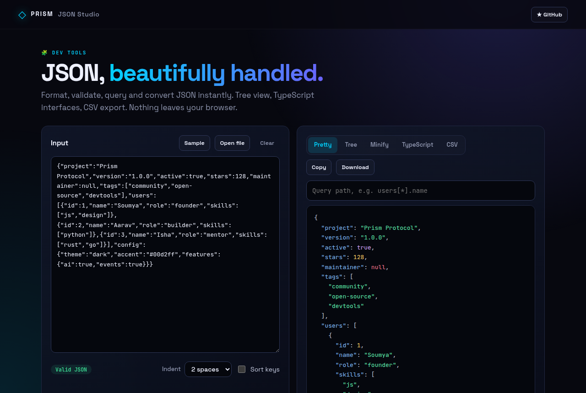
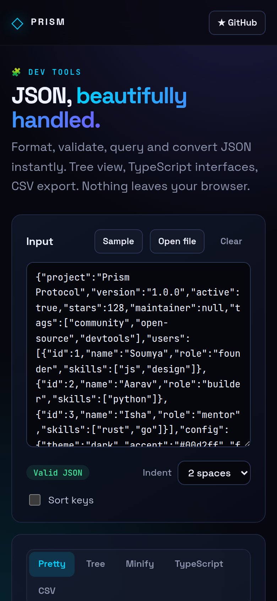

<!-- ═════════════ HEADER ═════════════ -->
<p align="center">
  
</p>

<p align="center">
  
</p>

<p align="center">
  <a href="https://github.com/krishyaa06/prism-json-studio/actions/workflows/ci.yml"></a>
  <a href="https://krishyaa06.github.io/prism-json-studio/"></a>
  
  
  <a href="LICENSE"></a>
</p>

<p align="center">
  
</p>


## ⚡ Overview

**Prism JSON Studio** is a fast, private JSON workbench. Paste or open a file and it is validated as you type, with the exact line and column of any error. Switch between pretty, tree, minified, TypeScript and CSV views, run path queries, and copy or download the result. Everything runs locally in your browser.

## ✨ Features

- **Live validation** with line and column of the first error
- **Pretty / Minify** with 2, 4 or tab indentation and optional key sorting
- **Collapsible tree view** with color-coded types
- **Path queries** like `config.features.ai` or `users[*].name`
- **JSON → TypeScript** interfaces, including nested objects and arrays
- **JSON → CSV** for arrays of objects
- **Stats**: size, key count, depth and nodes
- Open `.json` files, copy, download, and your input is saved locally

## 📸 Screenshots

<table>
  <tr>
    <td width="68%"></td>
    <td width="32%"></td>
  </tr>
</table>

## 🚀 Quick Start

**Use it online:** [https://krishyaa06.github.io/prism-json-studio/](https://krishyaa06.github.io/prism-json-studio/)

**Run locally:**

```bash
git clone https://github.com/krishyaa06/prism-json-studio.git
cd prism-json-studio
# open index.html in your browser, or serve it:
npx serve .
```

## 🛠️ Usage

| Action | How |
| --- | --- |
| Validate | Paste JSON in the left panel; the status pill shows errors with line/column |
| Query | Type a path in the query box: `users[0].name`, `users[*].skills`, `$.config.theme` |
| Convert | Switch tabs: **Pretty**, **Tree**, **Minify**, **TypeScript**, **CSV** |
| Export | **Copy** or **Download** the current view |

## 📁 Project Structure

```
prism-json-studio/
├── assets/
│   ├── logo.png
│   └── logo.svg
├── css/
│   ├── app.css
│   └── prism.css   # shared Prism design system
├── js/
│   ├── app.js   # UI wiring
│   ├── core.js   # pure logic (parse, query, TS/CSV) — tested in Node
│   └── prism.js
├── test/
│   └── core.test.js
├── .gitignore
├── LICENSE
├── README.md
├── index.html
└── package.json
```

## 🧪 Tests

```bash
npm test
```

Tests use the built-in `node:test` runner, so there is nothing to install. CI runs them on Node 20 and 22.

## 🤝 Contributing

1. Fork the repo and create a branch: `git checkout -b feature/my-idea`
2. Make your change and add a test in `test/`
3. Run `npm test` and open a Pull Request

## 🔷 Part of Prism Protocol

Prism JSON Studio is one of the open-source tools built by [Prism Protocol](https://dc.gg/prismprotocol), a tech community where young builders learn, ship and compete together.

## 👤 Author

<table>
  <tr>
    <td align="center">
      <a href="https://github.com/krishyaa06"><br><b>Soumya Bhandare</b></a><br>
      <sub>Founder @ Prism Protocol</sub>
    </td>
    <td>
      <a href="https://dc.gg/prismprotocol"></a><br>
      <a href="https://instagram.com/prism_protocol_"></a><br>
      <a href="https://x.com/krishyaa06"></a>
    </td>
  </tr>
</table>

## 📄 License

Released under the [MIT License](LICENSE).

<p align="center">
  <b>If you like this project, consider giving it a ⭐</b><br>
  <sub>"Build. Create. Compete." · Made with ⚡ by Prism Protocol</sub>
</p>


